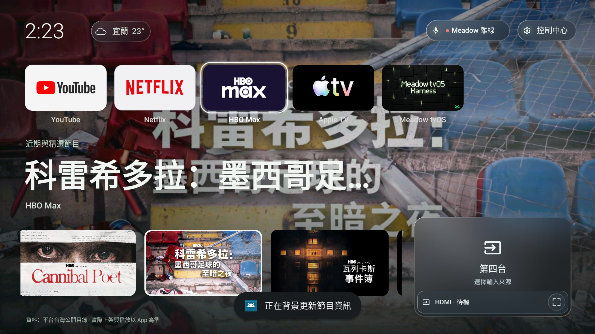
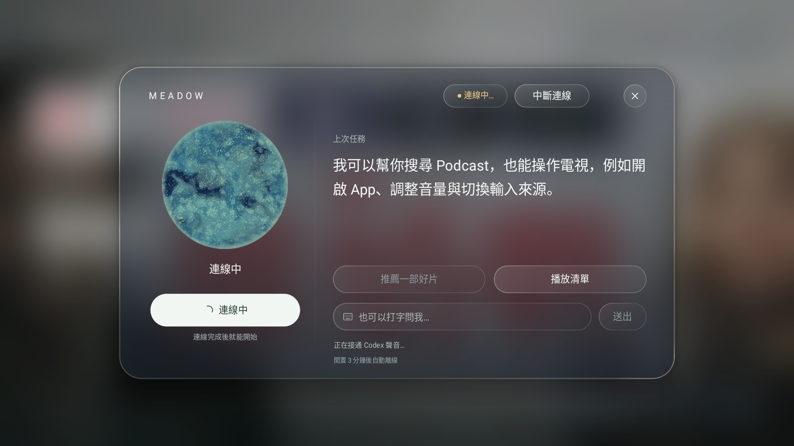
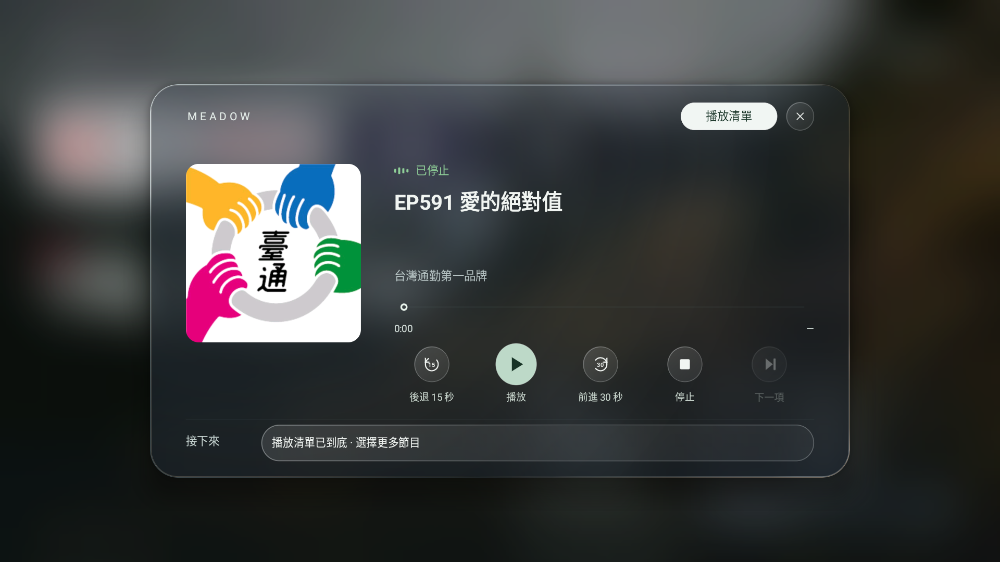
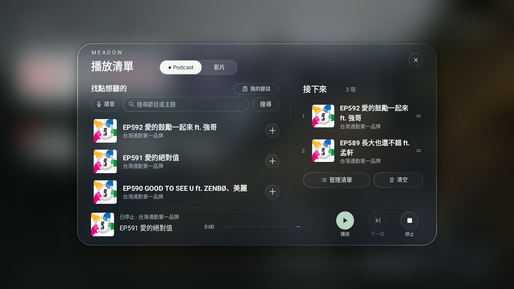
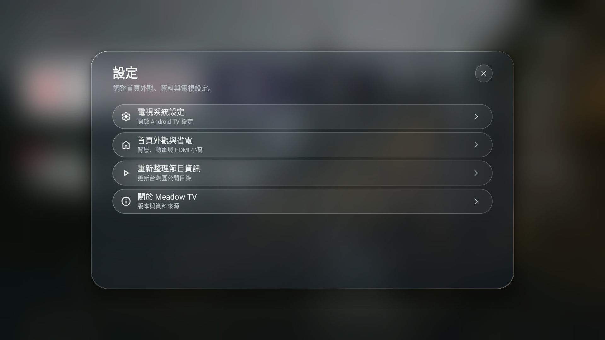
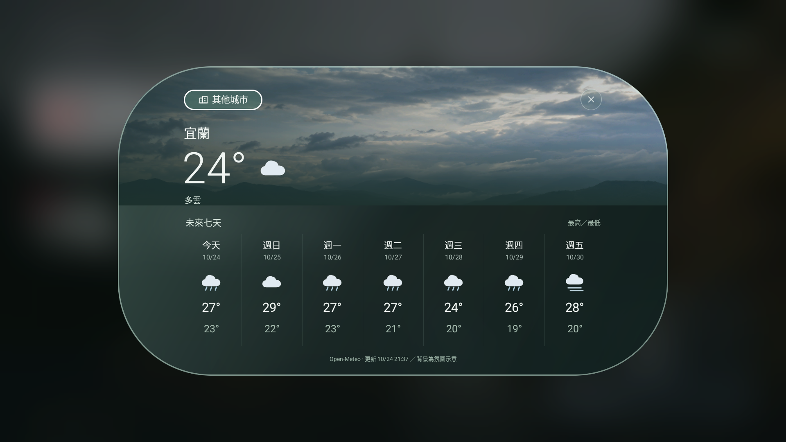
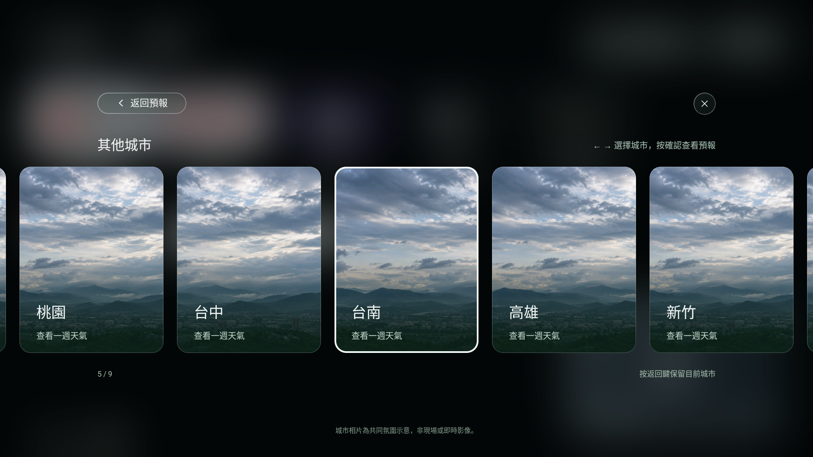

# Meadow TV

**讓電視首頁，更貼近你想看的內容。**

Meadow TV 為 Android TV 帶來簡潔的玻璃介面，把常用 App、影片推薦、Podcast 與天氣放在一起。拿起遙控器就能瀏覽；連接 Mac 後，也能請 Meadow 助理搜尋節目、安排播放清單與操作電視。

[下載預覽版](https://github.com/akaiHuang/meadow-tv/releases/tag/v0.8.16-preview.1) · [安裝與 Codex 連接教學](docs/GETTING-STARTED.zh-TW.md)

## 在 Meadow TV 裡

- **你的電視首頁** — 常用 App 一目了然，方向鍵焦點清楚，控制中心隨時可開啟。
- **找到下一部想看的影片** — 瀏覽 Netflix、HBO Max 與 Apple TV 的台灣公開節目精選。
- **聽點喜歡的內容** — 搜尋 Podcast、收藏自己的節目，把單集加入播放清單。
- **看看這週的天氣** — 七日預報與城市卡片，直接在首頁查看。
- **和 Meadow 聊聊** — 連接自己的 Codex，透過文字或支援的語音功能搜尋內容、開啟 App 與控制播放。

## 畫面預覽

<table>
  <tr>
    <td width="50%"><strong>Meadow 助理</strong> </td>
    <td width="50%"><strong>Podcast 播放器</strong> </td>
  </tr>
  <tr>
    <td><strong>播放清單</strong> </td>
    <td><strong>控制與設定</strong> </td>
  </tr>
  <tr>
    <td><strong>七日天氣</strong> </td>
    <td><strong>其他城市</strong> </td>
  </tr>
</table>

*畫面取自開發版模擬器，部分圖示與外觀可能隨安裝的 App 及版本而不同。*

## 開始使用

Meadow TV 支援 **Android TV 9 以上的 ARMv7／ARM64 裝置**。首頁、天氣與 Podcast 可直接使用；Meadow 助理另需一台 **Apple Silicon Mac**，以及具有 Codex 存取權的 ChatGPT 帳號。

1. [下載 Meadow TV](https://github.com/akaiHuang/meadow-tv/releases/tag/v0.8.16-preview.1)，將 APK 安裝到電視。
2. 依照[連接教學](docs/GETTING-STARTED.zh-TW.md)，在自己的 Mac 登入 Codex 並配對電視。
3. 開啟右上角 Meadow，試著說或輸入：「幫我找幾個台灣 Podcast」。

使用助理時，Mac 需保持開機並執行 Meadow 中控。登入使用你自己的 ChatGPT 帳號，**不需要另外申請 API key**；可用模型與額度依帳號方案而定。

## 預覽版說明

目前提供 Android TV APK 與 macOS Apple Silicon 中控。語音仍為實驗功能，依 Codex 版本、帳號及遙控器支援情況而異；語音不可用時可使用文字。HDMI 小窗與投放功能也依電視硬體而異。

影音 App 需另行安裝及登入。推薦內容來自公開目錄，實際可觀看的節目以各平台為準。Meadow TV 是 Android TV 首頁 App，安裝時保留原有作業系統。

[常見問題](docs/GETTING-STARTED.zh-TW.md#常見問題) · [隱私與安全](docs/SECURITY.md) · [相容性說明](docs/VERIFICATION.md)

## 開發與授權

歡迎透過 [Issues](https://github.com/akaiHuang/meadow-tv/issues) 回報問題或建議；開發者可參考[建置說明](docs/BUILD.md)。

本倉庫公開 Android TV App 與 adapter 原始碼，尚未指定整體程式碼授權。Mac 中控包含未公開的 Meadow Core，使用者可下載預編譯版本。第三方元件與商標說明見[第三方來源](THIRD_PARTY_NOTICES.md)。
