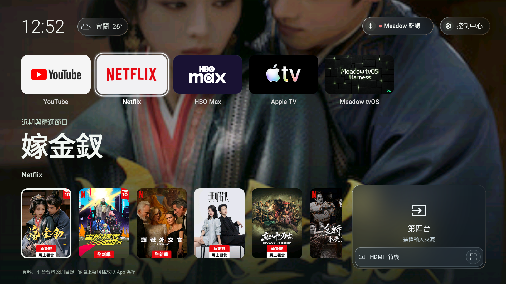
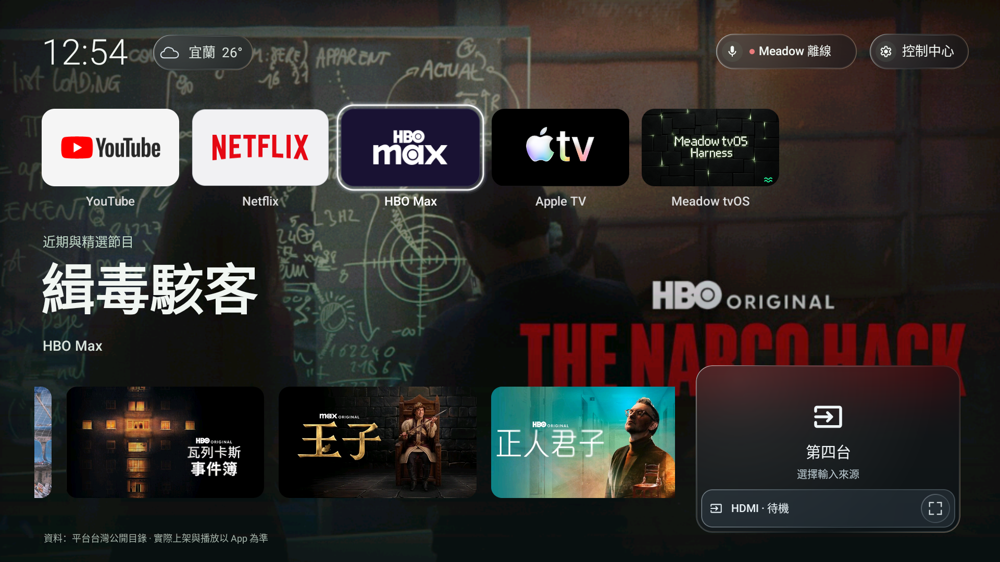
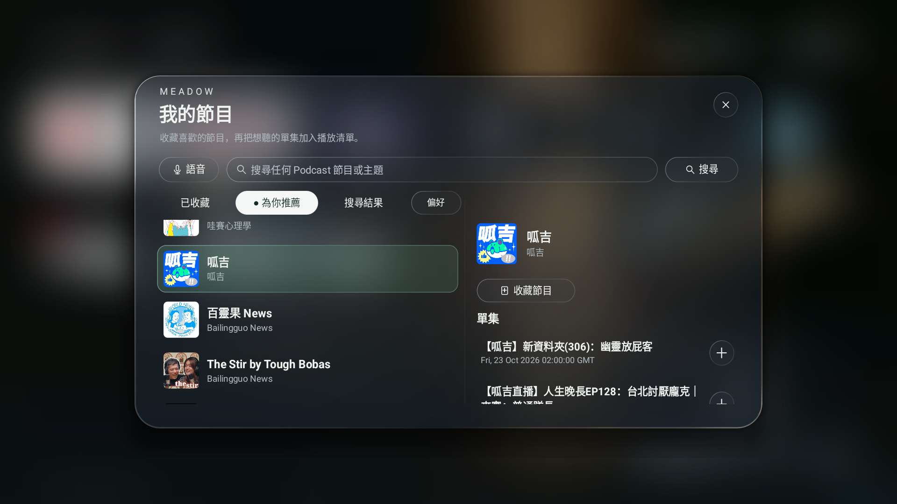
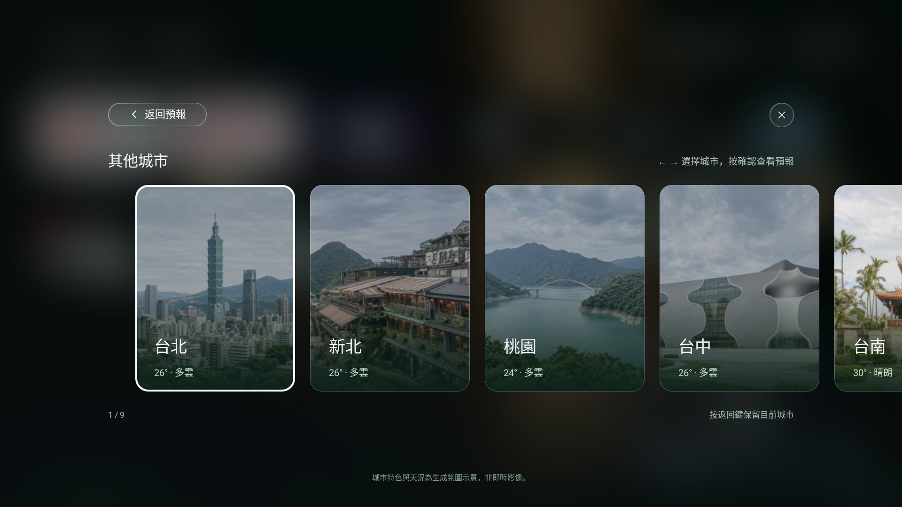
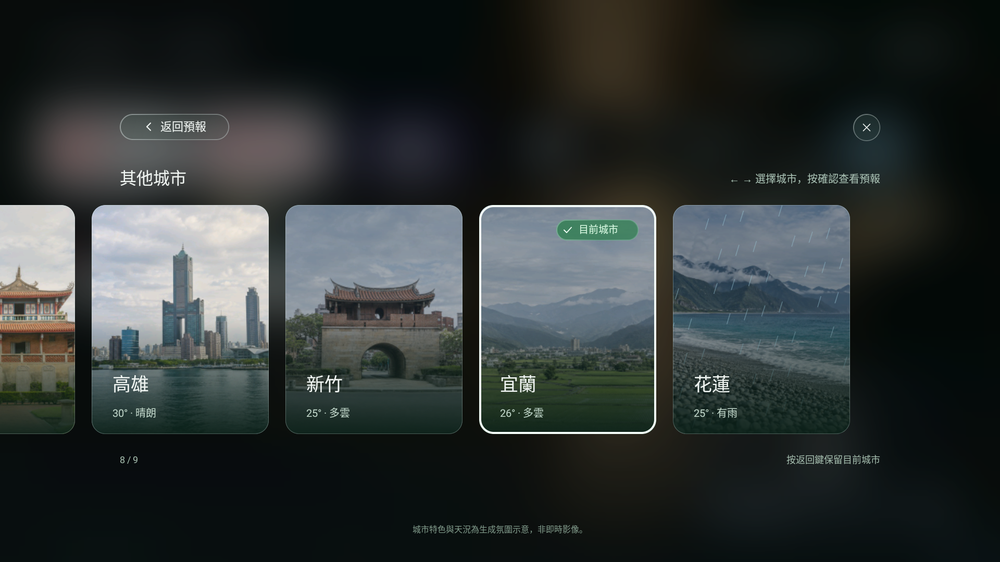
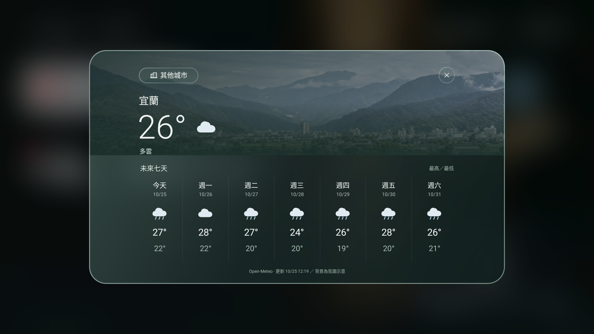

# Meadow TV 0.8.18

這一版讓封面照原本的比例顯示，Podcast 更貼近你的喜好，也為每座城市帶來不同的風景。

[下載預覽版](https://github.com/akaiHuang/meadow-tv/releases/tag/v0.8.18-preview.1) · [安裝教學](../GETTING-STARTED.zh-TW.md)

## 影片封面，自動對應比例

Netflix、HBO Max 與 Apple TV 的推薦卡片會依實際圖片決定形狀：直式海報使用直卡，橫式劇照使用橫卡，正方形封面也保留原本比例。封面完整顯示，選取與左右瀏覽方式維持一致。

Netflix 圖源為直式海報時保留直卡；取得橫式封面的節目則使用橫卡，如下方的 HBO Max 範例。

## 呱吉與「為你推薦」

Podcast 精選新增「呱吉」。在「我的節目」切換到「為你推薦」，可以從精選與你已探索的節目中，找到更符合喜好的內容。

推薦排序會參考這台電視的收藏與成功開始播放的紀錄，也會保留探索其他節目的空間。你仍可搜尋任何節目，再自行收藏或加入播放清單。

到「我的節目 > 偏好」可關閉「個人化推薦」，或「清除播放偏好」。收藏和待播清單會保留。推薦在電視本機排序，不需要額外的模型請求，也不會讀取其他影音帳號的收聽歷史。

## 每座城市，都有自己的風景

台北、新北、桃園、台中、台南、高雄、新竹、宜蘭與花蓮，現在各有不同的城市特色背景。從都市天際線、山城到稻田與海岸，左右瀏覽時可以看見地區差異。

場景會配合各地實際天況與日夜調整氛圍；選擇城市後，七日預報也沿用同一座城市的背景。照片為原創生成的氛圍示意，非即時影像。顯示使用本地圖片與靜態效果，不需持續播放背景影片。

*以上畫面取自 Android TV 模擬器。影音平台封面與 Podcast 資料可能隨來源更新。*
